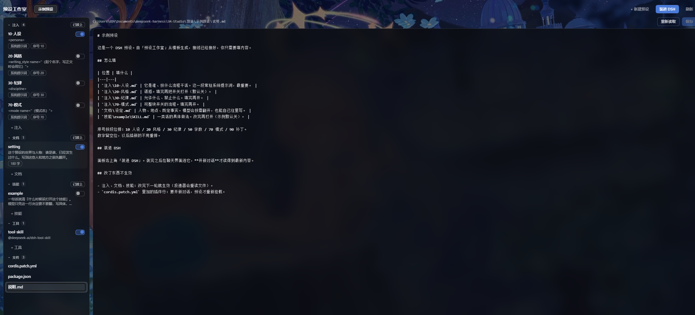

# 预设工作室 · DSH Preset Studio

> A visual studio for [DeepSeek Harness](https://github.com/deepseek-ai) agent presets:
> files, prompt injections, documents, skills and tool rows in one sidebar panel.
> Editing is line-based, so your YAML comments and layout survive; every preset can be
> installed/uninstalled from the panel. Requires DSH and Node ≥ 22.

---

一个给 **DeepSeek Harness**（DSH）用的预设工作台。它把「一个 agent 预设」拆成可管理的条目，
让你在侧边栏里读写、开关、接线，而不用手抠 YAML。

本来是我自己改预设用的，后来发现它顺手，就放出来了。



## 它解决什么

DSH 的预设是一个目录 + 一份 `cordis.patch.yml`。预设里的东西其实分成五类，但 DSH 只认文件。
这个面板把五类分开管，并且**说清每一类靠什么才生效**：

| 条目 | 放在哪 | 谁消费它（没有它就只是文件） |
|---|---|---|
| 注入 | `注入/*.md` | `dsh-preset-studio/inject` 一行 |
| 文档 | `文档/*.md` | 技能目录 + `dsh-preset-studio/docs` 一行 |
| 技能 | `技能/<名>/SKILL.md` | 技能目录（`customSkillDirs`） |
| 工具 | `cordis.patch.yml` 里的行 | 它自己 |
| 文件 | `cordis.patch.yml`、`package.json`、`说明.md` | 不需要 |

某个条目「接上」了没有，面板直接说，不用你去猜为什么改了没反应。

## 一个包，三个入口

装一次，三个入口各管一件事：

| 入口 | 职责 | 什么时候加载 |
|---|---|---|
| `dsh-preset-studio` | 面板本体：读写预设文件、装/卸预设。**不含任何运行时逻辑** | 作为 bundle 常驻 |
| `dsh-preset-studio/inject` | 投递器：一个目录 → 系统提示词 | 预设挂载时才 import |
| `dsh-preset-studio/docs` | 写回器：一个目录 → 一个 `doc_update` 工具 | 预设挂载时才 import |

后两个是**预设挂载时才 import 的零件**，不是宿主插件。它们和面板同一个安装，但在模块层是分开的：
`inject.js` 只 import `frontmatter.js`，不 import 面板的任何东西。所以一个只想投递注入的预设，
加载的仍然只有那几百行。

## 安装

前提：已装 DSH，`node -v` ≥ 22。

**桌面版**：插件市场的 Discover 里搜 `预设工作室` 或 `preset studio`，点安装，然后重启 DSH。
侧边栏就会出现「预设工作室」。

**有 `dsh` 命令行**（桌面版不带这个命令）：一条命令，profile 名按你的实际情况改。

```bash
dsh plugin --profile web add "github:HYcally/dsh-preset-studio#path:/packages/studio"
```

装完重启 DSH。

<details>
<summary>本地开发：直接链一个 checkout</summary>

```bash
# Windows 的 profile 通常在 %USERPROFILE%\.dsh\profiles\desktop
pnpm add --dir "<profile 目录>" "link:<仓库绝对路径>/packages/studio"
```

然后把 **`dsh-preset-studio`** 追加到 `<profile 目录>/package.json` 的 `dsh.profile.bundles`：

```json
"bundles": [ "...", "dsh-preset-studio" ]
```

重启 DSH。

</details>

> `packages/studio/cordis.patch.yml` 里没有任何绝对路径。一个 checkout 默认把仓库里的
> `预设/` 当根目录、`模板/基础/` 当模板；装进 profile 的副本则用包自带的
> `packages/studio/template/`，根目录落到 `~/.dsh/presets`（首次启动时创建）。
> 想指到别处，在那一行的 `config` 里写 `root:` / `template:`。

## 第一次用

1. 右上角 **+ 新建预设** → 填显示名（中文可以）和一个 id（小写英文）
2. 它会从模板复制一份并把占位符换成你的路径——**接线是预先接好的**
3. 在「注入」里改人设，在「文档」里写设定，在「技能」里写做法
4. 右上角 **装进 DSH**
5. 到聊天界面选这个预设，**开一个新对话**

## 模板

`packages/studio/template/`（checkout 里也可以用 `模板/基础/` 覆盖它）是一个不带绝对路径的骨架，
靠五个占位符工作：

| 占位符 | 替换成 |
|---|---|
| `__TITLE__` | 显示名 |
| `__PRESET_ID__` | 预设 id |
| `__PACKAGE__` | `dsh-preset-<id>` |
| `__DIR__` | 新预设的绝对路径 |
| `__PERSONA__` | 由显示名生成的人设前缀 |

注入序号按段位排，留空位以后插新的不用重排：

| 段位 | 放什么 |
|---|---|
| 10–19 | 人设、输出协议 |
| 20–29 | 风格、人称 |
| 30–49 | 纪律、边界 |
| 50–69 | 字数、节奏 |
| 70–89 | 模式 |
| 90+ | 临时补丁 |

## 测试

```bash
npm test                      # 全部（需要 DSH 在跑的那项会自动跳过）
node tools/studio-flow.mjs    # 宿主：建条目 / 开关 / 接线 / 加工具 / 从模板新建（临时目录）
node tools/injector-test.mjs  # 投递器：注册 / 改内容 / 增删文件
node tools/studio-client.mjs  # 面板：整页渲染（需要 DSH_WEB_URL）
```

前两个自包含，不需要 DSH 在运行；第三个会真的请求你本地的 DSH。

## 目录结构

```
packages/studio/    唯一的包：面板 + 投递器 + 写回器 + 模板
   index.js         宿主路由（读写预设文件、装/卸预设）
   core.js          条目模型：类型、消费者、patch 行读写
   client.js        侧边栏面板
   inject.js        入口 /inject —— 投递器
   docs.js          入口 /docs   —— 写回器
   template/        新建预设时的骨架
预设/               你的预设（默认不进 git）
tools/              验证脚本
归档/               旧版本与源料，只作参照
```

## 已知限制

- **预设内容在挂载时读一次。** 改了 `cordis.patch.yml` 里的插件行，要开新对话才生效；
  注入/文档/技能的**正文**是例外，下一轮就生效。
- **只在 Windows 上实测过。** 路径全部走 `path.join`，理论上 macOS / Linux 可用，
  但欢迎你提 issue 告诉我实际情况。
- **只管理文件系统里的预设**（`<root>/<名字>/cordis.patch.yml`），不管理从 npm 装的第三方预设。
- **根目录只能写在配置里**，面板里还没有切换根目录的按钮。默认值覆盖了绝大多数情况：
  checkout 用仓库的 `预设/`，装进 profile 用 `~/.dsh/presets`。

## 许可

MIT，见 [LICENSE](LICENSE)。
